# Vocaby

給中文使用者的英文單字 iOS App。不只背單字，還會告訴你這個字可以取代哪種比較白話的說法，讓你的表達更精準。先學字、接著練習，App 會幫你記下每個字什麼時候該再複習。

<table>
  <tr>
    <td align="center">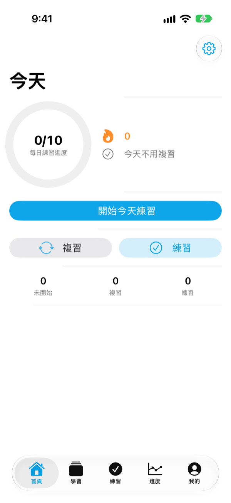 今天要學什麼</td>
    <td align="center">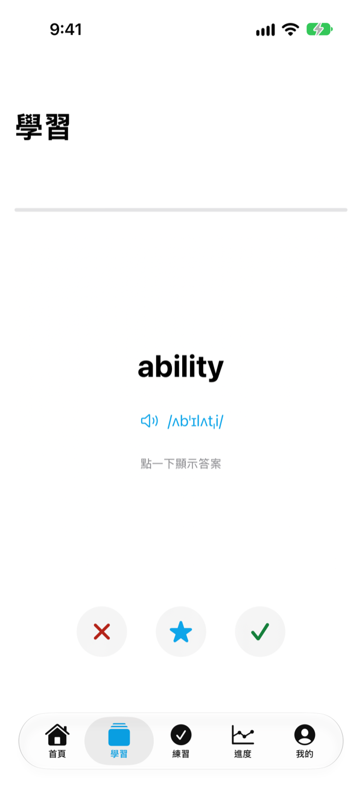 翻開學習卡</td>
    <td align="center">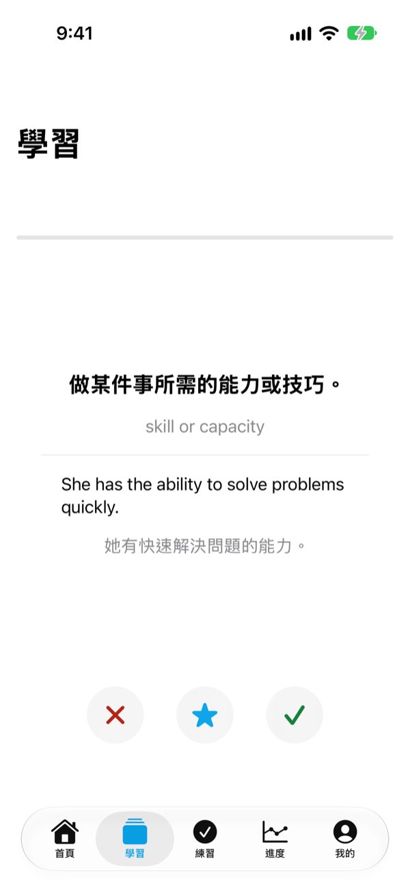 看意思與例句</td>
    <td align="center">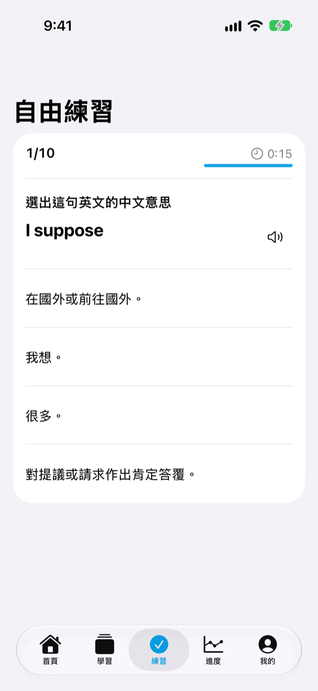 練習鞏固</td>
  </tr>
</table>

## 功能特色

### 📅 每天一點點

- **每日目標**：每天要學幾個字由你決定，可以在 10 到 100 個之間、以 5 個為一級調整
- **今天的待辦一眼看懂**：首頁就看得到今天的進度、要複習的字與連續學習天數
- **每日提醒**：設定提醒時間，時間到通知你回來學

### 🃏 雙面學習卡

- 正面是英文與音標，點一下翻到背面看中文意思、例句與翻譯
- 往三個方向滑動就能標記「認識」「不認識」或「收藏」
- 可以自動播放發音，邊看邊聽

### 🔁 記下每個字該複習的時間

依照每個字的記憶程度（SM-2 間隔複習）算出下一次該複習的時間，首頁會顯示今天有幾個字該複習。

### ✏️ 多種練習方式

- 四種題型：選更自然的說法、選中文意思、聽發音選答案、拼寫英文，也可以混合出題
- 題數與每題作答時間都可以調整
- 答錯的題目可以馬上再練一次

<table>
  <tr>
    <td align="center">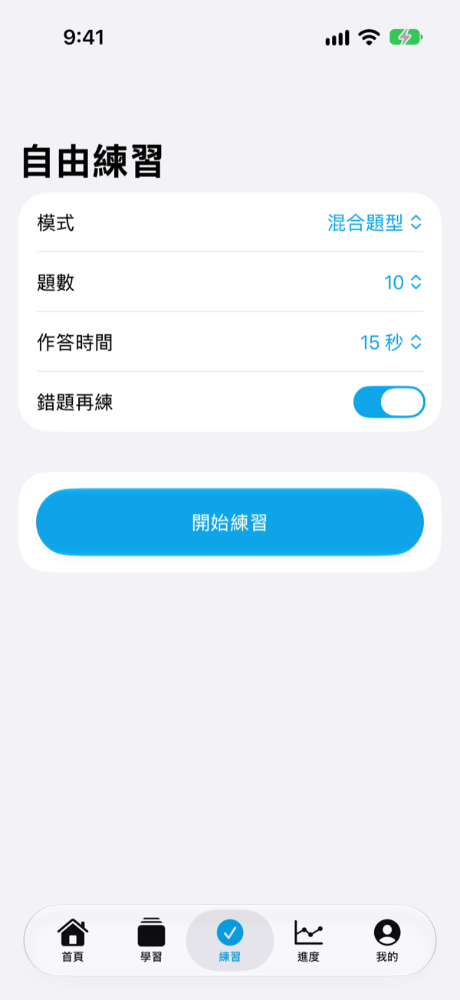 自訂練習</td>
    <td align="center">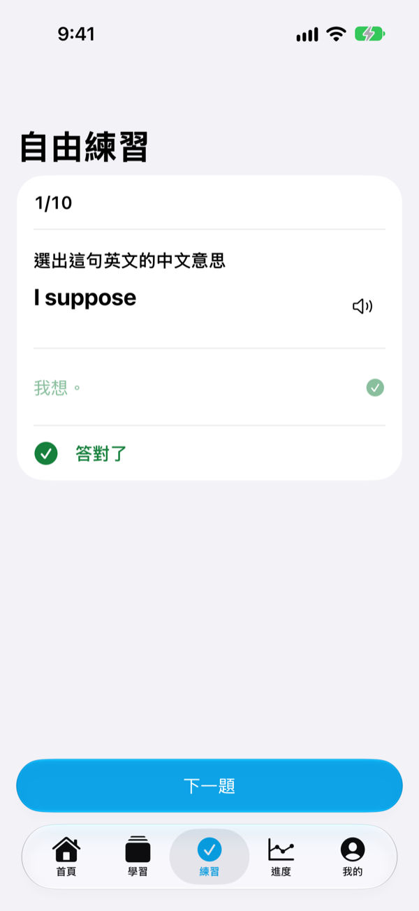 即時回饋</td>
    <td align="center">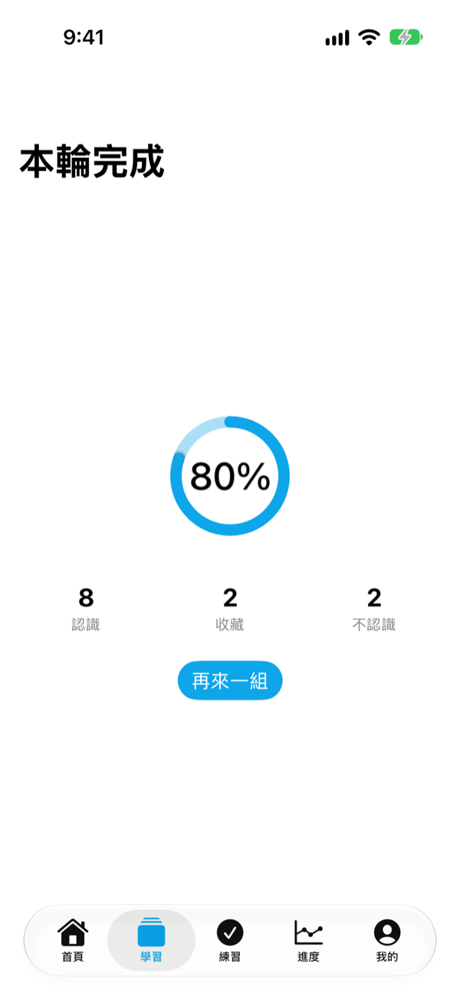 學完一輪的成績</td>
    <td align="center">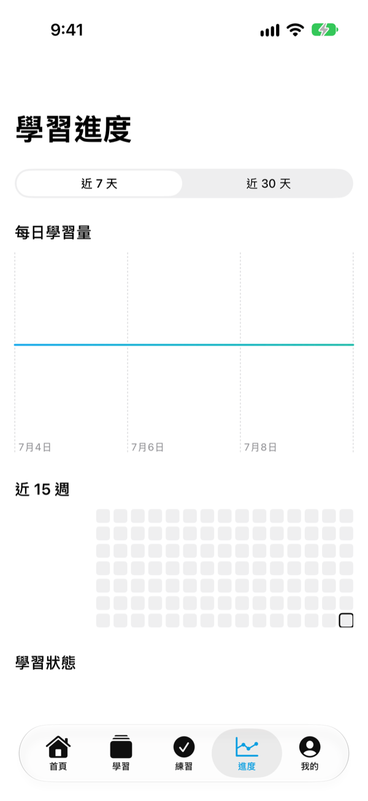 學習進度</td>
  </tr>
</table>

### 📈 看得見的進步

- **學習趨勢**：近 7 天與近 30 天的每日學習量
- **15 週熱度圖**：哪幾天有學、哪幾天偷懶，一張圖看完
- **學習狀態**：有多少字正在學、多少字已經掌握
- **成就徽章**：達成連續學習等里程碑時解鎖徽章，還有慶祝動畫

### 📚 內建 18,000 多個單字與片語

收錄超過 18,000 個經過審核的單字與片語，分成基礎、中階、進階三個程度，每個都有音標、中英文解釋與例句。全部內建在 App 裡，不需要網路也能學。單字、解釋與發音整理自多個開放授權的辭典與字表，來源與授權條款見 [ThirdPartyNotices.txt](Vocaby/Resources/ThirdPartyNotices.txt)。

### 📱 桌面小工具

在主畫面放上小工具，不用打開 App 就看得到今天的學習進度；中型小工具還會顯示下一個要學的表達。進度會在你回到 App 首頁時更新。

<table>
  <tr>
    <td align="center">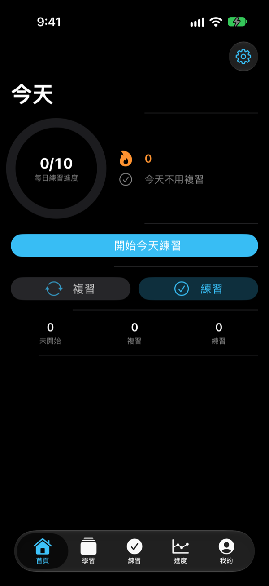</td>
    <td align="center">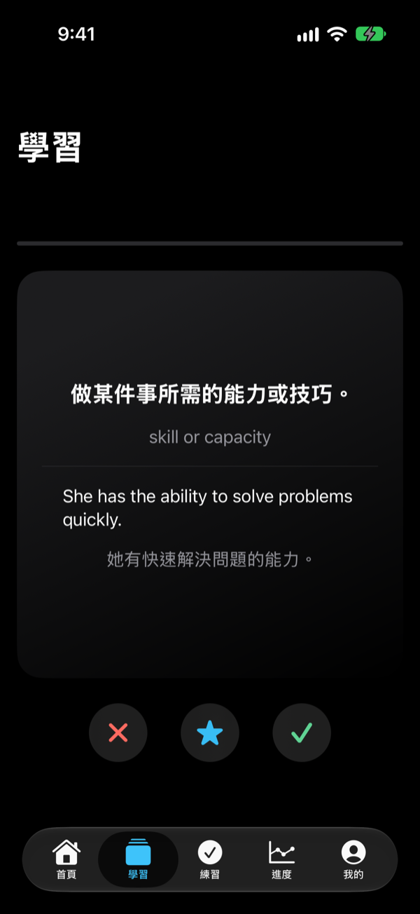</td>
    <td align="center">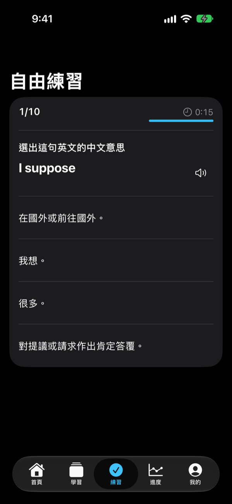</td>
    <td align="center">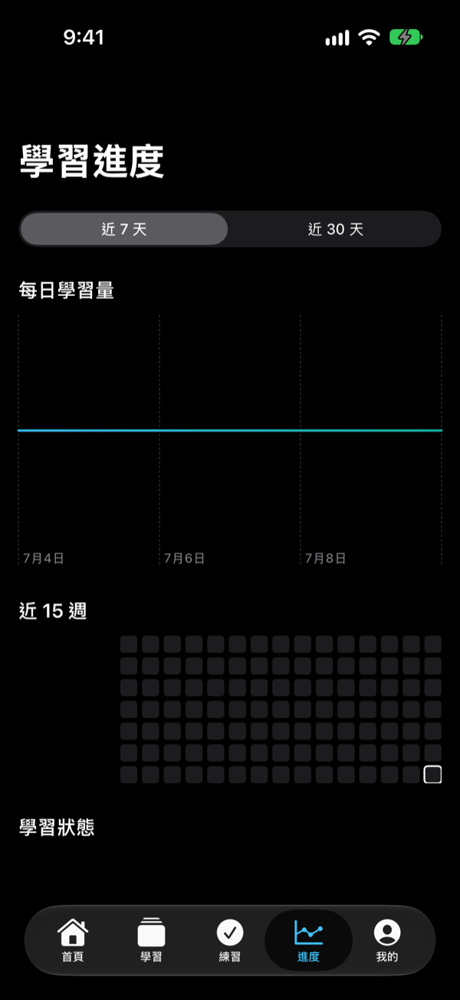</td>
  </tr>
</table>

支援深色模式，外觀可以跟隨系統或自行選擇。
